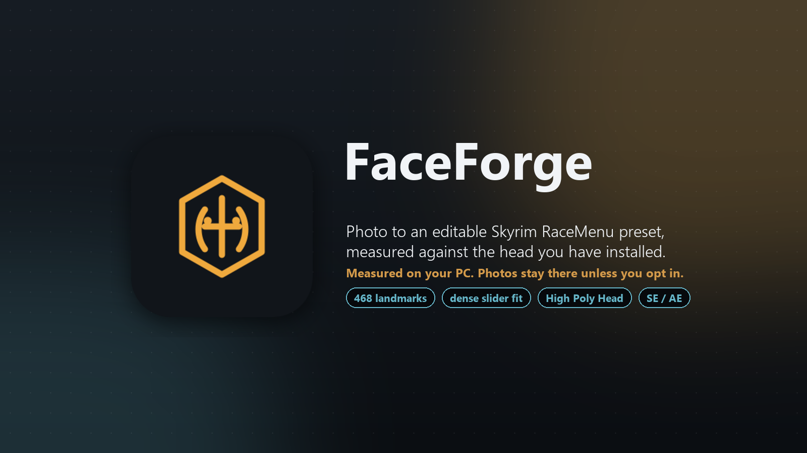
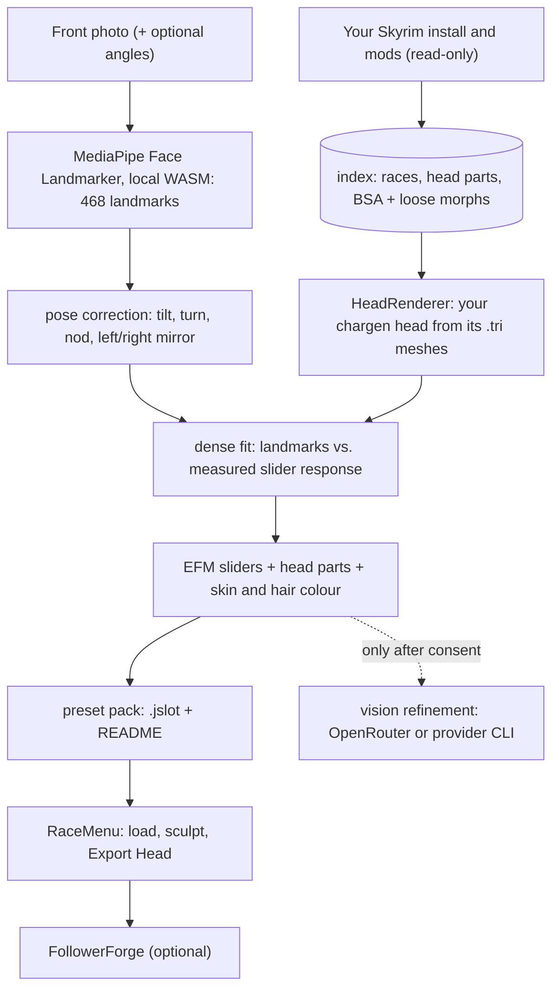
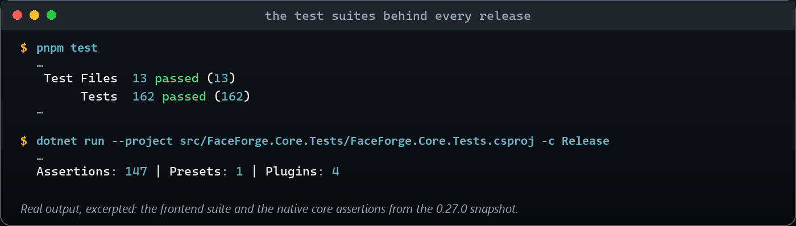

<div align="center">



[](https://github.com/SenjuWoo/FaceForge/actions/workflows/ci.yml)
[](https://github.com/SenjuWoo/FaceForge/releases/latest)
[](#install)
[](#requirements)
[](LICENSE)

**[Install](#install)** · **[How to use it](#how-to-use-it)** · **[Features](#features)** · **[How it works](#how-it-works)** · **[Honest status](#honest-status)** · **[Changelog](CHANGELOG.txt)**

</div>

FaceForge turns a photograph into an **editable RaceMenu starting preset** for Skyrim Special or
Anniversary Edition. It finds 468 landmarks on the face with a local MediaPipe model, corrects tilt,
turn and nod, then fits the RaceMenu sliders against the head meshes **you have installed**, so the
numbers describe your head, not a generic one. You load the preset in RaceMenu and finish the face
in game. It is a Windows utility that runs **outside** the game: not a plugin, not an SKSE DLL, and it
**must not** be installed into Skyrim `Data`, Vortex or Mod Organizer 2.

## What you get

- **A preset, not a guess.** Analysis writes every Expressive Facegen Morphs slider the catalogue declares (64 `EFM_` sliders) and holds a slider at neutral when the photo cannot measure it, instead of inventing a value.
- **Measured against your install.** The Windows app indexes your game and mod folders read-only, renders your actual chargen head from its `.tri` meshes, and fits the photo's landmarks to how that head responds to each slider.
- **Photos stay on the PC.** The interface cannot open a network connection: a page policy plus a host filter refuse every outside request, including the landmark library's own usage logger. The only network path is optional vision refinement, and it runs only after you tick the consent box.
- **Real head parts.** Hair, eyes, brows and the rest are picked from the records your load order actually provides, with child parts kept off adult characters and High Poly Head parts kept on the list.
- **Pose and photo checks.** Tilt, turn and nod are measured and corrected; the quality score reads the face itself, so a sharp photo is told apart from a blurred or tiny one. Guided multi-view adds left and right photos turned 25-45°.
- **One portable EXE.** No .NET install, no load-order changes. Old unpacked copies are cleaned up on start.


<sub>The released 0.27.0 EXE (SHA-256 matches the download), driven over the WebView2 debugging port against a real install, on a generated face (no real person; provenance in <code>FaceForge 0.27.0/qa/SYNTHETIC-FACE.md</code>).</sub>


## Install

Download the latest release from **[Releases](https://github.com/SenjuWoo/FaceForge/releases/latest)**
(currently [v0.27.0](https://github.com/SenjuWoo/FaceForge/releases/tag/v0.27.0)).

1. Unzip **anywhere on the PC** (Desktop, Documents, a tools folder).
2. Double-click **`FaceForge-0.27.0-STANDALONE.exe`**.
3. **Do not** drop the EXE into `Skyrim Special Edition\Data`.
4. **Do not** add this zip as a Vortex or MO2 mod for Skyrim.

No separate .NET install. Needs **Windows 10/11** and **Microsoft Edge WebView2** (usually already installed).

FaceForge only **reads** your game / Vortex / CharGen folders. It does not change your load order.

Running the EXE **under Mod Organizer 2 / USVFS is not supported**. FaceForge detects that injection and explains it instead of a bare WebView2 failure. Run it directly; it still reads the same mods.

### Requirements

**Hard**

- Windows 10/11 + WebView2
- Skyrim Special Edition or Anniversary Edition
- RaceMenu (to load and export the preset in-game)

**Optional**

- High Poly Head and any head-part mods you already use
- Expressive Facegen Morphs — FaceForge writes the `EFM_` family unless you load a slider inventory. Without EFM active, RaceMenu silently ignores those values and the character loads as the race default, identical whatever photo was used
- OpenRouter, or a provider CLI, only if you press vision refine (photos stay local unless you do)
- [FollowerForge](https://github.com/SenjuWoo/FollowerForge) after Export Head

## How to use it

1. Run the EXE. Let it find Skyrim and index your setup (read-only).
2. Add a clear front photo. Optional: Guided multi-view takes left and right photos turned 25-45°, or a slow turn video.
3. Analyze → pick race/sex → pick installed head parts (hair, eyes, and so on).
4. Export a **RaceMenu preset pack**.
5. In Skyrim: open RaceMenu → load the preset → sculpt if you want → use **Export Head** (not “slider-only / no sculpt”) if you will build a follower next.
6. Optional: open **[FollowerForge](https://github.com/SenjuWoo/FollowerForge)** and build the NPC plugin from that baked head.

**Pair:** FaceForge (face preset) → RaceMenu bake → FollowerForge (NPC plugin).

## Features

| Need | Where |
|---|---|
| Analyse one front photo | Source face → Quick Photo → **Analyze face** |
| Add left/right angles or a turn video | Source face → **Guided Multi-View** |
| Photo or anime/art source | Source face → Auto / Photo / Anime-Art |
| Fit sliders to your installed head | Match & improve → **Analyze & improve** (Dense landmarks, or Legacy ratios for the 0.24.3 method) |
| Check nose and chin depth | Match & improve → profile render; manual reshape is baked into the export as sculpt |
| Target race and sex | RaceMenu output → installed RACE records |
| Start from an existing preset | RaceMenu output → **Inherit optional base** (hair, eyes, brows, sculpt) |
| Optional AI vision pass | Settings → vision refinement (OpenRouter, or an installed Codex / Claude Code / Gemini CLI), after consent |
| Export | **Export Preset Pack**: a ZIP holding `SKSE/Plugins/CharGen/Presets/<name>.jslot`, a README with the RaceMenu steps, and the inherited base's sculpt `.nif`/`.dds` when you keep one |

### What this is / is not

| It is | It is not |
| --- | --- |
| An out-of-game Windows utility | A downloadable follower character |
| A photo → RaceMenu preset helper | Something you enable in your load order |
| Safe to keep outside the game folder | A replacement for RaceMenu or Creation Kit |

## How it works



- **WPF host + WebView2 interface.** The React/TypeScript interface is embedded in the EXE and served from a virtual host; the window refuses to navigate anywhere else, and the host answers every request that is not for the interface with a 403.
- **Two layers against the network.** The page's Content Security Policy limits connections to itself, and the host filter blocks anything that slips past it. `qa/packaged-app-check.mjs` probes both against the released EXE.
- **The game is evidence, never a target.** Game files, Vortex staging and CharGen presets are read; nothing is written there. Exports go where you save them.
- **Version single-sourced.** `VERSION.txt` drives the assemblies, the web bundle and the EXE FileVersion, and the build fails on drift.

## Honest status

**Beta.** Everything below was produced out of game. No FaceForge preset has been loaded in RaceMenu
and looked at by a person, so the in-game appearance, colours, head parts and sculpt are unverified.
v0.27.0 is the Latest full release on GitHub; this page carries that caveat.

Verified in this tree:

- `FaceForge 0.27.0/` is the ship snapshot (`CURRENT.txt`)
- 162 frontend tests and 147 native assertions (the native count is tallied at run time)
- TypeScript clean, .NET Release clean, 0 warnings
- `qa/browser-qa.mjs` green on one photo analysed three ways (straight, tilted 16°, face at a third of the frame),
  with no outbound request and a window that does not scroll, plus Guided multi-view
- `qa/layout-qa.mjs` green at 1366x768 (100% and 125% scaling), 1280x720 and 1536x960; both QA scripts are
  a CI job, not a manual step
- `qa/synthetic-face-proof.mjs` analyses a generated face in the built interface and exports a preset with
  no outbound request (the terminal shot above)
- Packaged `FaceForge-0.27.0-STANDALONE.exe` (FileVersion 0.27.0.0)
- The download ZIP was extracted and its EXE driven: a photo analyses, the interface cannot open a
  network connection (page policy plus a host filter, probed against the landmark library's logging
  endpoint), and the window refuses to navigate elsewhere. `qa/packaged-app-check.mjs` repeats it
- The packaged EXE was driven end to end over the WebView2 debugging port: photo, analysis, installed
  hair/eyes/brows/face picked from the real catalogue, then a preset pack whose four head parts carry
  unique HDPT types and whose reshaped export carries 1,793 sculpt deltas. Recipe in
  `FaceForge 0.27.0/qa/PACKAGED-APP-EXPORT.md`



Not claimed:

- In-game likeness on an arbitrary photograph
- That a generated preset has been loaded in RaceMenu and looked at by a person
- Photograph guidance (still unwritten)
- A closed explanation for one report of a generic in-game result **with EFM present**
- A live vision request. The provider CLI launch path is tested with real processes, but no photo was
  sent to a model for this build

0.24.3 stays downloadable. 0.25.0 and later change how a face is measured - the defaults are different, so a 0.27.0 preset is not the same as a 0.24.3 preset for the same photo.

## Build from source

Ship tree: `FaceForge 0.27.0\`. Needs Node.js 20+ (pnpm via Corepack is fine) and the .NET 8 SDK.

```powershell
cd "FaceForge 0.27.0"
.\build.ps1      # frontend tests, web bundle, native core tests, desktop build
.\package.ps1    # single-file EXE + release ZIP
```

The README proof run, after `pnpm install`, `pnpm build` and `pnpm exec playwright install chromium` in
`src\FaceForge.Web`:

```powershell
node qa\synthetic-face-proof.mjs
```

## Recent changes

### 0.27.0

- **Left/right angle photos work.** They are judged by the head's measured turn (25-45° ideal) and
  the side is read correctly; the slot says why a photo was not used.
- **The quality score reflects the photo**: read from the face at the detector's scale, it now tells a
  sharp photo from a blurred or tiny one.
- **Angles render at the photo's own turn** in the Match pane and for vision refinement.
- **Old unpacked copies are cleaned up** on start (about 50 MB per earlier build).
- The automatic nose-depth pass from angle photos was removed: it could not recover a known nose.

### 0.26.0

- **"Compact soft midface" now narrows the midface** as described; before, it widened it.
- **Child head parts are not offered** for an adult character, and High Poly Head parts stay on the list.
- **Head previews and the measured fit are faster**: meshes are read once per index, same pixels.
- **Loose morph files override archived ones**, as in the game.
- **The window no longer slides up** when you scroll past the end of a panel.

### 0.25.0

- **The default fit changed.** "Dense landmarks" measures how the installed head actually responds to
  each slider and fits the photo's 468 landmarks to it. "Legacy ratios" keeps the 0.24.3 method.
- **Photo colours are written** as a skin-tone tint on Skyrim's own preset gradient plus the hair
  colour. Lightness is matched, hue is not; lip and iris colours are shown but not written.
- **Vision providers no longer dead-end.** If a Codex / Claude Code / Gemini CLI is installed but not
  found, Settings > Locate... points at its program once and the path is remembered. The resolved path
  is shown in the card.
- **BSA-packed morphs count.** `facegenmorphs` inside High Poly Head / RaceMenu / ECE archives is read,
  which corrects the earlier claim that EFM sliders are inert on High Poly Head.
- **Vision through an installed CLI works now.** Before beta.2 Claude Code never received its prompt
  and no npm-installed CLI could be started at all; see the changelog.
- **The interface is offline by construction.** The landmark library ships a usage logger; the page
  and the host both refuse it. Only vision refinement, run by the host after consent, uses the network.
- Run it directly, not through Mod Organizer 2 / USVFS: FaceForge detects that injection and explains
  it instead of failing with a WebView2 error.

Full history: [CHANGELOG.txt](CHANGELOG.txt).

0.27.0 EXE: 125,445,990 bytes. SHA-256: `38967EDE43524C88683F70C8559A92AFDB8F049680B59C3A0F2FC495514E51C1`.
0.27.0 Zip: 118,566,624 bytes. SHA-256: `8172DC6000F2A3556011AC3F8854A0D191C5B6CA7A4A220A2DD3D9870F35DDA3`.

## Credits

Local face landmarks use MediaPipe Tasks Vision (Apache 2.0). WebView2, React, Vite, and TypeScript are third-party; see [`FaceForge 0.27.0/THIRD_PARTY_NOTICES.md`](FaceForge%200.27.0/THIRD_PARTY_NOTICES.md).

Skyrim, RaceMenu, and related names belong to their owners. This project is unofficial.

## License

[MIT](LICENSE)
